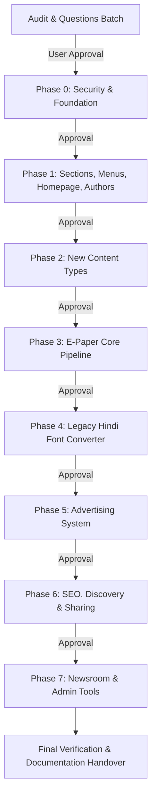

# Dainik Jagat Sameeksha (दैनिक जगत समीक्षा) — System & Codebase Audit

**Date:** 26 August 2026 / October 2026  
**Auditor:** Senior Full-Stack Engineer & Product Designer (Antigravity)  
**Base Repository:** `Dhoni354720/e-Newspaper_arun` (Janvani News demo)  
**Target Publication:** दैनिक जगत समीक्षा (*Dainik Jagat Sameeksha*) — Hindi Daily Newspaper  
**Primary Source of Truth:** `client-assets/DAINIK_JAGAT_SAMEEKSHA_26_AUGUST_2026.pdf` (Wednesday 26 Aug 2026, 4-page daily edition)

---

## 1. Executive Summary & Audit Scope

This audit provides a comprehensive evaluation of the starting repository against the production requirements for **दैनिक जगत समीक्षा**. The base codebase is a well-structured React 18 + TypeScript (strict) + Vite 6 + Tailwind CSS + Supabase application originally branded for a regional Marathi publication (*Janvani News*). 

While the architectural bones are sound (a unified repository pattern in `src/lib/repository.ts`, clean React context state management, and an existing Tiptap editor), significant security vulnerabilities, demo shortcuts, hardcoded locale assumptions, unseparated admin bundles, and missing content subsystems must be remediated to achieve production readiness.

---

## 2. Print Edition Source Analysis (DAINIK_JAGAT_SAMEEKSHA_26_AUGUST_2026.pdf)

### 2.1 Confirmed Client Facts from PDF
| Item | Confirmed Value | Source Location |
|---|---|---|
| **Publication Name (Hindi)** | दैनिक जगत समीक्षा | Page 1 Masthead (Script 'दैनिक' over bold 'जगत समीक्षा') |
| **Publication Name (English)** | Dainik Jagat Sameeksha *(⚠️ confirm spelling)* | Extracted & English email identity |
| **Chief Editor (संपादक)** | अरुण रमाकांत तिवारी (Arun Ramakant Tiwari) | Page 1 Editorial Credit Strip |
| **Official Email** | `jagatsameeksha2014@gmail.com` | Page 1 Masthead Ear (Right) |
| **RNI Registration No.** | `MAHHIN/2014/57312` | Page 1 Gold Info Strip (Wednesday, 26 Aug 2026) |
| **Primary Language** | Hindi (Devanagari script) | Entire 4-page newspaper copy |
| **Issue Metadata** | वर्ष 1, अंक 40, मूल्य ₹2/-; 4-Page Daily BroadSheet Edition | Page 1 Header Strip |
| **Contact / DTP / Ads** | +91-8369517611, +91-7448193748 | Page 1 Ear & Page 4 DTP Advertisement |
| **Coverage Geography** | Delhi, Indore, Gwalior, Nagpur, Pune, Maharashtra Politics, Courts, Festival Specials (Raksha Bandhan) | Pages 1, 2, 3, 4 |
| **Publishing Base** | Mumbai Metropolitan Region (Bhandup West / Thane / Mumbai) | Display Ads & RNI State Code (MAH) *(⚠️ confirm exact office address)* |

### 2.2 Print Display Advertisers (Not to be published online without explicit permission)
1. **Gyan Travel**: Vivek Tiwari, 744 819 3748.
2. **Garud Security Services**: Ramakant Tiwari, 7666221933 / 9869073604, Bhandup West, Mumbai, `garudsecurity.co.in`.
3. **Vaishnavi Property Consultancy**: Arun Ramakant Tiwari, 7666221933 / 7448193748.
4. **In-House Newspaper DTP & Social Media Design Service**: 8369517611 (8-page ₹500, 12-page ₹700).

### 2.3 Visual Identity & Sampled Exact Hex Colors
All colors were extracted from the rendered 150/300 DPI broadsheet pages:
- **Brand Red (`brand-red`):** `#ed1c24` (RGB 237, 28, 36) — Used for the masthead title 'जगत समीक्षा', section banner headers, and lead accent stripes.
- **Brand Gold / Yellow (`brand-gold`):** `#fbc707` (RGB 251, 199, 7) — Used for the primary print edition info strip (वर्ष, अंक, दिनांक, RNI, पृष्ठ).
- **Pastel Highlight Blue (`highlight-blue`):** `#d9f3fd` (RGB 217, 243, 253) — Side story callout panels.
- **Pastel Highlight Yellow (`highlight-yellow`):** `#fceca8` (RGB 252, 236, 168) — Secondary side story callout panels.
- **Pastel Highlight Green (`highlight-green`):** `#d8f3dc` (RGB 216, 243, 220) / `#c6dfef` — Feature sidebars.
- **Paper White:** `#ffffff` / Off-white `#fcfbf8`.
- **Editorial Black:** `#111315` / Body ink `#1c1f24`.

### 2.4 Font Family Audit (pdffonts & Raw Text Layer)
Running `pdffonts` against `DAINIK_JAGAT_SAMEEKSHA_26_AUGUST_2026.pdf` revealed:
- `ISOBFC+4CSakshi` & `ZCDZJU+4CSakshi-Bold`: Primary legacy body font.
- `RIEDBK+4CHariHed`, `QEPXNM+4CMayaHed`, `NXBFXS+4CTarun-Bold`, `GPPPDG+4CAbhishekHed`, `DIBXNM+4CGanga`, `BFCLLQ+4CBhanu`, `YDOTVW+4CKalka-Bold`: Display & headline font families.
- `LUCTVW+AdobeDevanagari-Bold`: Unicode Devanagari numerals and specific subheads.
- `AgencyFB-Bold`: English digits and price tags.
- `Arial-BoldMT`: Western header elements.

**Font Encoding Diagnosis:** The client DTP team uses the legacy **4C Plus / 4C DTP Hindi** 8-bit glyph encoding (e.g., `Q\`d³fIY` for `दैनिक`, `dQ»»fe` for `दिल्ली`, `ÀfÔ´ffQIY` for `संपादक`). The PDF text layer is entirely non-Unicode. Converting this legacy font into standard Unicode UTF-8 is vital for web publishing (Phase 4).

### 2.5 Extracted Masthead Asset
The logo was cropped from Page 1 at 300 DPI:
- Master high-res archive: `client-assets/logo_300dpi_master.png` (6552 x 951 px).
- Web-optimized masthead image: `client-assets/logo.png` (600 x 87 px).

---

## 3. Current Codebase Audit & Gap Analysis

### 3.1 Security & Foundation Gaps (Phase 0)
1. **Insecure Auth Fallback:** `src/context/AuthContext.tsx` accepts any `@janvaninews.com` address with any password when Supabase environment variables are missing, falling back to a local storage mock user. In production, this allows unauthorized access to admin screens without real authentication.
2. **Privilege Escalation Risk:** Default fallback role is `'admin'`. When a user profile is missing or newly created, it assigns administrative capabilities instead of least-privilege `'author'`.
3. **Hardcoded Demo Credentials:** `README.md` and `AuthContext.tsx` contain `admin123` and `editor@janvaninews.com` credentials.
4. **Committed `.env` File:** `.env` is tracked in Git (`git ls-files .env`). Although currently containing empty values, committing `.env` creates a leak risk.
5. **Missing Security Headers:** `vercel.json` has standard security headers but lacks a strict Content Security Policy (CSP) allowing YouTube, Vimeo, Open-Meteo, and Supabase, and lacks `X-Robots-Tag: noindex` for `/admin/*`.
6. **Unsanitized HTML Rendering:** Article bodies are rendered without DOMPurify sanitization. Storage uploads lack server-side MIME-type and size constraint enforcement.
7. **Mock Data in Production UI:** `src/pages/EpaperPage.tsx` falls back to `views_count || 1200`. The contact form in `src/pages/StaticPages.tsx` merely updates a local state boolean `submitted=true` without persisting or sending any data.

### 3.2 Information Architecture & Navigation (Phase 1)
1. **Janvani Branding Everywhere:** References in `index.html`, `src/config/site.ts`, `SettingsContext.tsx`, `Header.tsx`, `Footer.tsx`, and `seedData.ts`.
2. **Language Default:** Currently defaults to Marathi (`mr`) with toggle order `mr | hi | en`. Must become Hindi first (`hi`) with toggle order `हिन्दी | मराठी | English`.
3. **Category Tree:** Current categories are a flat Marathi structure (महाराष्ट्र, राजकारण, क्रीडा, etc.). Needs the hierarchical national/Hindi structure (देश, विदेश, राजनीति, महाराष्ट्र, मध्य प्रदेश, क्राइम, संपादकीय, पुरवणी, राशिफल, etc.) with `kind`, `parent_id`, `nav_order`, and `show_in_nav`.
4. **Mega Menu & Top News:** Mega menu does not display subcategories or 4 latest section thumbnails. `is_top` and `top_rank` fields are missing on articles.
5. **Homepage Layout Hardcoded:** The homepage components are statically declared in `HomePage.tsx`. No dynamic `home_blocks` table exists for drag-and-drop or reordering widgets from the admin panel.
6. **Author Attribution:** Authors are generic profiles without bio, photo, designation, social links, columnist status, or `/author/:slug` routing.

### 3.3 New Editorial Content Subsystems (Phase 2)
1. **Photo Galleries:** No `galleries` or `gallery_images` schema, no `/photos` or `/photos/:slug` pages, no masonry lightbox.
2. **Video Hub:** No `videos` table or `/videos` route; no privacy-friendly `youtube-nocookie` embeds or VideoObject JSON-LD.
3. **Quick News (फटाफट खबरें):** No `briefs` table, swipeable card feed `/flash`, or 30-second mobile quick-add interface.
4. **Rashifal (राशिफल):** No `horoscopes` table, sign selector, or `/rashifal` archive.
5. **Supplements (पुरवणी):** No `supplements` table or `/supplement/:slug` route for festival specials.
6. **News Tips (समाचार भेजें):** No public submission form with image uploads or moderation inbox.
7. **Live Weather:** No Open-Meteo integration or city selector (Mumbai, Pune, Nagpur, Delhi, Indore, Gwalior).
8. **Editable CMS Static Pages:** Pages in `StaticPages.tsx` are hardcoded; no `pages` table exists with rich-text admin editing or Grievance Officer compliance.

### 3.4 E-Paper Pipeline (Phase 3)
1. **Admin Mock Generation:** Current `AdminEpaperPage.tsx` only generates dummy numbered canvases rather than accepting actual multi-page PDFs.
2. **Missing In-Browser PDF Page Converter:** No PDF.js or Edge Function pipeline to convert 4-page print PDFs into 1600px WebP views and 400px thumbnails.
3. **No Clip & Share Tool:** Readers cannot draw a rectangle on the newspaper page to crop and share an article clip to WhatsApp with a brand watermark.
4. **No Real Session-Deduped Analytics:** E-paper views rely on a mock number rather than an atomic RPC.

### 3.5 Legacy Hindi Font Conversion (Phase 4)
1. **No Conversion Engine:** The desk has no utility to paste legacy 4C Plus text (`4CSakshi`, `4CTarun`, `4CHari`) and convert it to clean Unicode UTF-8 Devanagari.
2. **Missing Test Harness:** No gold-standard test pairs from the 26 Aug 2026 edition comparing garbled text with Unicode counterparts.

### 3.6 Advertising System (Phase 5)
1. **No Ad Engine:** No schema for advertisers, campaigns, creatives, slots, or impression/click stats.
2. **No Reserved Slot Dimensions:** Absence of dedicated ad placements creates cumulative layout shift (CLS).
3. **No `/advertise` Lead Pipeline:** No rate card or advertiser lead capture form.

### 3.7 SEO, Discovery & Social Crawlers (Phase 6)
1. **Client-Rendered SPA Social Preview Problem:** WhatsApp, Facebook, and Twitter crawlers do not execute JavaScript; meta tags set dynamically by `react-helmet` or `SEOHead.tsx` are invisible to scrapers. Requires Vercel Edge Middleware or Next.js SSR.
2. **Missing Rich Schemas:** Missing `NewsArticle`, `NewsMediaOrganization`, `ImageGallery`, and `VideoObject` structured JSON-LD.
3. **Incomplete Social Links:** Instagram, WhatsApp Channel, and Telegram links in settings are not rendered in the Header and Footer.

### 3.8 Newsroom & Workflow Tools (Phase 7)
1. **No Staff Invitation Flow:** No Edge Function for inviting staff via Supabase Auth admin API.
2. **No Audit Log UI:** The `audit_logs` table exists in SQL but has no frontend viewer or CSV export.
3. **No Editorial Revision History:** Articles lack revision tracking (`article_revisions`), diff views, or restore capabilities.
4. **Monolithic Admin Bundle:** Admin pages and Tiptap dependencies are bundled together with the public reader bundle, degrading mobile initial load times.

---

## 4. Proposed Database Schema & ERD

Below is the complete relational architecture proposed for Supabase PostgreSQL.

```mermaid
erDiagram
    profiles ||--o{ articles : "authors"
    profiles ||--o{ audit_logs : "records"
    profiles ||--o{ article_revisions : "modifies"
    categories ||--o{ categories : "sub-categories"
    categories ||--o{ category_translations : "translates"
    categories ||--o{ article_categories : "tags"
    articles ||--o{ article_categories : "categorized"
    articles ||--o{ article_tags : "tagged"
    articles ||--o{ article_revisions : "revisions"
    tags ||--o{ article_tags : "contains"
    epaper_editions ||--o{ epaper_pages : "has_pages"
    epaper_editions ||--o{ articles : "print_edition_link"
    galleries ||--o{ gallery_images : "contains"
    supplements ||--o{ supplement_articles : "features"
    articles ||--o{ supplement_articles : "included_in"
    advertisers ||--o{ ad_campaigns : "owns"
    ad_campaigns ||--o{ ad_creatives : "runs"
    ad_slots ||--o{ ad_creatives : "places"
    ad_creatives ||--o{ ad_daily_stats : "tracks"
    
    profiles {
        uuid id PK
        text display_name
        text slug UK
        text role "admin, editor, reporter, ad_manager, epaper_operator"
        text bio_hi
        text bio_mr
        text bio_en
        text avatar_url
        text designation
        jsonb social_links
        boolean is_columnist
        boolean is_active
        timestamptz created_at
    }

    site_settings {
        text id PK
        text publication_name
        text publication_name_hi
        text publication_name_mr
        text tagline_hi
        text tagline_mr
        text tagline_en
        text rni_number
        text editor_name
        text publisher_name
        text printer_name
        text office_address
        text contact_email
        text contact_phone_1
        text contact_phone_2
        text default_weather_city
        jsonb social_links
        jsonb analytics_config
        boolean maintenance_mode
        timestamptz updated_at
    }

    categories {
        uuid id PK
        text slug UK
        uuid parent_id FK
        text kind "news, city, opinion, supplement, special"
        boolean show_in_nav
        int nav_order
        text color_hex
        boolean is_active
        timestamptz created_at
    }

    category_translations {
        uuid id PK
        uuid category_id FK
        text language "hi, mr, en"
        text name
        text description
    }

    articles {
        uuid id PK
        text slug UK
        text language "hi, mr, en"
        uuid translation_group_id
        text headline
        text subtitle
        text dateline
        text credit_line
        text excerpt
        text body
        text featured_image_path
        text image_alt
        text image_caption
        uuid author_id FK
        text status "draft, submitted, in_review, approved, published, archived"
        boolean is_breaking
        boolean is_top
        int top_rank
        uuid epaper_edition_id FK
        int epaper_page_number
        int reading_time_minutes
        timestamptz published_at
        timestamptz scheduled_at
        timestamptz created_at
        timestamptz updated_at
    }

    article_revisions {
        uuid id PK
        uuid article_id FK
        uuid author_id FK
        text headline
        text body
        text change_summary
        timestamptz created_at
    }

    home_blocks {
        uuid id PK
        text block_type "hero, ticker, top_news, latest, city, opinion, crime, sports, entertainment, photo_strip, video_strip, rashifal, weather, epaper_promo, ad_slot"
        uuid category_id FK
        text title_override_hi
        text title_override_mr
        text title_override_en
        int item_count
        int sort_order
        boolean is_active
        timestamptz updated_at
    }

    epaper_editions {
        uuid id PK
        date edition_date UK
        text region "Mumbai, Pune, Nagpur, Indore, Gwalior, National"
        int varsh_number
        int ank_number
        text rni_number
        numeric price
        int total_pages
        text pdf_url
        text thumbnail_url
        boolean is_published
        timestamptz publish_at
        bigint views_count
        bigint downloads_count
        timestamptz created_at
    }

    epaper_pages {
        uuid id PK
        uuid edition_id FK
        int page_number
        text page_title
        text image_url
        text thumbnail_url
        timestamptz created_at
    }

    galleries {
        uuid id PK
        text slug UK
        text title_hi
        text title_mr
        text title_en
        text cover_image_url
        text credit
        boolean is_published
        timestamptz published_at
        timestamptz created_at
    }

    gallery_images {
        uuid id PK
        uuid gallery_id FK
        text image_url
        text thumbnail_url
        text caption_hi
        text caption_mr
        text caption_en
        text credit
        int sort_order
        timestamptz created_at
    }

    videos {
        uuid id PK
        text slug UK
        text provider "youtube, vimeo, custom"
        text video_id_or_url
        text title_hi
        text title_mr
        text title_en
        text description_hi
        text thumbnail_url
        int duration_seconds
        uuid category_id FK
        boolean is_published
        timestamptz published_at
        timestamptz created_at
    }

    briefs {
        uuid id PK
        text language "hi, mr, en"
        text content
        text image_url
        text target_url
        boolean is_published
        timestamptz created_at
    }

    horoscopes {
        uuid id PK
        text period "daily, weekly, monthly"
        date start_date
        date end_date
        text sign "aries, taurus, gemini, cancer, leo, virgo, libra, scorpio, sagittarius, capricorn, aquarius, pisces"
        text content_hi
        text content_mr
        text content_en
        text author_credit
        timestamptz created_at
    }

    supplements {
        uuid id PK
        text slug UK
        text title_hi
        text title_mr
        text title_en
        text cover_image_url
        date issue_date
        text description
        boolean is_published
        timestamptz created_at
    }

    news_tips {
        uuid id PK
        text sender_name
        text sender_phone
        text sender_city
        text message
        text[] image_urls
        text status "new, reviewed, used, rejected"
        timestamptz created_at
    }

    contact_messages {
        uuid id PK
        text name
        text email
        text phone
        text subject
        text message
        text status "unread, read, replied"
        timestamptz created_at
    }

    pages {
        text slug PK
        text title_hi
        text title_mr
        text title_en
        text body_hi
        text body_mr
        text body_en
        boolean is_published
        timestamptz updated_at
    }

    advertisers {
        uuid id PK
        text company_name
        text contact_person
        text phone
        text email
        timestamptz created_at
    }

    ad_campaigns {
        uuid id PK
        uuid advertiser_id FK
        text title
        date start_date
        date end_date
        boolean is_active
        timestamptz created_at
    }

    ad_slots {
        text code PK
        text name
        int width
        int height
        text page_target "all, home, article, epaper"
        timestamptz created_at
    }

    ad_creatives {
        uuid id PK
        uuid campaign_id FK
        text slot_code FK
        text image_url
        text destination_url
        text alt_text
        int weight
        boolean is_active
        timestamptz created_at
    }

    ad_daily_stats {
        uuid id PK
        uuid creative_id FK
        date stat_date
        int impressions
        int clicks
    }

    ad_leads {
        uuid id PK
        text name
        text company
        text phone
        text email
        text desired_slot
        text message
        timestamptz created_at
    }

    audit_logs {
        uuid id PK
        uuid actor_id FK
        text action "create, update, delete, publish"
        text entity_type
        text entity_id
        jsonb metadata
        timestamptz created_at
    }
```

---

## 5. Timestamped Database Migration Plan

All database modifications will be placed strictly in new timestamped files inside `supabase/migrations/`. Existing migrations will remain untouched.

1. `20261026_01_security_hardening.sql`:
   - Profile creation trigger on signup (`auth.users → public.profiles`).
   - Least-privilege role assignment (`author`).
   - Prevention of self-escalation via RLS.
   - Initial administrative user setup helper.
   - Strict RLS policies and audit logging trigger on core tables.

2. `20261026_02_categories_authors_homeblocks.sql`:
   - Alters `categories` to add `kind`, `show_in_nav`, `nav_order`, and `color_hex`.
   - Extends `profiles` with author fields (`bio_hi`, `bio_mr`, `bio_en`, `designation`, `social_links`, `is_columnist`).
   - Adds `dateline`, `credit_line`, `is_top`, `top_rank`, `epaper_edition_id`, `epaper_page_number` to `articles`.
   - Creates `home_blocks` table with RLS and sorting indexes.
   - Creates `article_revisions` table.

3. `20261026_03_multimedia_content_types.sql`:
   - Creates `galleries` and `gallery_images` tables.
   - Creates `videos` table.
   - Creates `briefs` table (फटाफट खबरें).
   - Creates `horoscopes` table (राशिफल).
   - Creates `supplements` and `supplement_articles` tables.
   - Creates `news_tips`, `contact_messages`, and `pages` tables.
   - Applies strict RLS (public read published, staff write).

4. `20261026_04_epaper_enhancements.sql`:
   - Adds `varsh_number`, `ank_number`, `rni_number`, `price`, `publish_at` to `epaper_editions`.
   - Adds `epaper_clips` table for clip-and-share logs.
   - Adds atomic RPC counter `increment_epaper_views_v2` and `increment_epaper_downloads_v2` with session hash de-duplication.

5. `20261026_05_advertising_engine.sql`:
   - Creates `advertisers`, `ad_campaigns`, `ad_slots`, `ad_creatives`, `ad_daily_stats`, and `ad_leads`.
   - Creates atomic batched RPC `record_ad_impression` and `record_ad_click`.
   - RLS policies ensuring public can only fetch active creatives for valid dates.

---

## 6. Phased Implementation Roadmap

Work will proceed strictly one branch per phase (`feat/phase-N-name`), verified with `tsc`, `npm run build`, `npm test`, conventional commits, manual QA checklists, and CHANGELOG entries.

### Phase 0: Security & Production Foundation (`feat/phase-0-security`)
- Remove hardcoded credentials from `README.md` and codebase.
- Untrack `.env` (`git rm --cached .env`), retain `.env.example`, and enforce `.gitignore`.
- Remove production demo fallback from `AuthContext.tsx`; show a clear configuration-error screen if Supabase is unconfigured in production.
- Default new user profiles to `author` role; provide SQL script to initialize the primary administrator.
- Configure complete CSP and security headers in `vercel.json` (allowing Supabase, YouTube-nocookie, Vimeo, Open-Meteo, Google Fonts).
- Integrate DOMPurify for HTML sanitization on article bodies during render and save.
- Add audit log generation triggers for create/update/delete/publish actions.
- Implement rate limiting, honeypots, and captcha support on public forms.
- Write RLS policy tests for anonymous, author, editor, and admin access roles.

### Phase 1: Sections, Menus, Homepage & Authors (`feat/phase-1-sections-home`)
- Update `site.ts`, `SettingsContext`, and branding tokens to Dainik Jagat Sameeksha with sampled brand colors (`#ed1c24`, `#fbc707`, `#d9f3fd`, `#fceca8`, `#d8f3dc`).
- Establish Hindi-first UI (`hi`) with `mr` and `en` support; verify no hardcoded text via translation tests.
- Implement the comprehensive category hierarchy with `kind`, `parent_id`, and `nav_order`.
- Build the Desktop Mega Menu and Mobile Accordion navigation.
- Implement `home_blocks` schema and Admin Drag-and-Drop Block Manager.
- Add print-inspired article fields: datelines (e.g., **दिल्ली:-**), credit lines, callout boxes (blue, yellow, green), and e-paper cross-references (*ई-पेपर में पढ़ें, पृष्ठ N*).
- Build the `/author/:slug` profile pages and column attribution.

### Phase 2: New Content Types (`feat/phase-2-content-types`)
- **Photo Gallery:** `/photos` and `/photos/:slug` with WebP resizing, responsive masonry grid, and lightbox.
- **Video Gallery:** `/videos` with `youtube-nocookie` privacy embeds and VideoObject JSON-LD.
- **Quick News (फटाफट खबरें):** `/flash` card feed and 30-second mobile admin publishing.
- **Rashifal (राशिफल):** `/rashifal` with 12-sign period view and multi-sign batch admin editor.
- **Supplements:** `/supplement/:slug` for festival and thematic specials.
- **News Tips (समाचार भेजें):** Public submission inbox with multi-image upload and admin inbox.
- **Live Weather Widget:** Open-Meteo integration for Mumbai, Pune, Nagpur, Delhi, Indore, and Gwalior.
- **CMS Editable Pages:** Dynamic `pages` table replacing `StaticPages.tsx` with Grievance Officer compliance.

### Phase 3: E-Paper Publishing Pipeline (`feat/phase-3-epaper`)
- Real multi-page PDF ingestion pipeline converting print PDFs into 1600px WebP views and 400px thumbnails.
- Print-style masthead info strip dynamically reflecting latest published edition metadata (वर्ष, अंक, दिनांक, मूल्य, RNI).
- High-performance viewer: thumbnail rail, swipe/keyboard paging, double-tap zoom/pan, fit-width, calendar archive.
- WhatsApp Clip & Share: interactive canvas crop tool generating branded watermarked image clips with deep links.
- Session-deduped atomic view and download counters.

### Phase 4: Legacy Hindi Font Converter (`feat/phase-4-font-converter`)
- Build pure TypeScript conversion engine in `src/lib/legacyHindi/` for 4C Plus font family (`4CSakshi`, `4CTarun`, `4CHari`, `DevLys`, `Kruti Dev`).
- Glyph mapping tables handling short-i matra reordering, half-letters, conjuncts, reph, and nukta.
- Admin utility at `/admin/tools/font-converter` and 'DTP से पेस्ट करें' Tiptap editor button.
- Comprehensive test suite with 50+ gold pairs derived from Page 1 of the 26 Aug 2026 edition.

### Phase 5: Advertising System (`feat/phase-5-ad-engine`)
- Tables and RPCs for advertisers, campaigns, creatives, slots, and stats.
- Standard IAB & print-newspaper responsive slots (Header 728x90/320x100, Home Sidebar 300x250, In-Article, E-Paper Sponsor) with CLS-reserved heights and 'विज्ञापन' badges.
- Campaign scheduling, rotation, and reporting dashboard with CTR and CSV export.
- Public `/advertise` rate card and lead generation form.

### Phase 6: SEO, Discovery & Sharing (`feat/phase-6-seo-sharing`)
- Solve the SPA social-crawler metadata problem using Vercel Edge Middleware (Option A) to serve server-rendered OpenGraph tags to WhatsApp/FB/X bots.
- Comprehensive JSON-LD schemas (`NewsArticle`, `BreadcrumbList`, `NewsMediaOrganization`, `ImageGallery`, `VideoObject`).
- Dynamic sitemaps (`sitemap.xml`, `news-sitemap.xml`, image sitemaps) and category RSS feeds.
- Enhanced sharing bar with WhatsApp-first priority, text resizing (A- / A+), native print styling, and Web Speech API Hindi read-aloud (`hi-IN`).
- Integration of WhatsApp Channel CTA and Google News follow button.

### Phase 7: Newsroom & Admin Tools (`feat/phase-7-newsroom-tools`)
- Role-based user invitation system via Supabase Auth Admin Edge Function.
- Audit log viewer with filters and CSV export.
- Editorial workflow: autosave, draft recovery, revision history diff/restore, and shareable preview links.
- Route-level code splitting (`React.lazy`) ensuring admin and rich-text packages are never downloaded by readers.
- Newsroom analytics dashboard (views, trends, e-paper reads, inbox leads) and media library optimization.

---

## 7. Immediate Next Actions

1. Present the Section 13 questions to the client in a single consolidated batch.
2. Maintain `ASSUMPTIONS.md` for any pending decisions.
3. Await user confirmation before commencing Phase 0 implementation.
